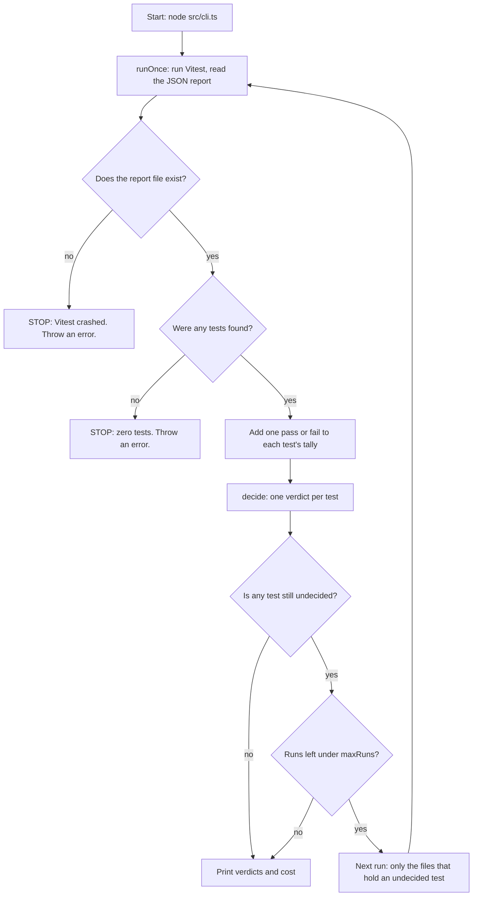
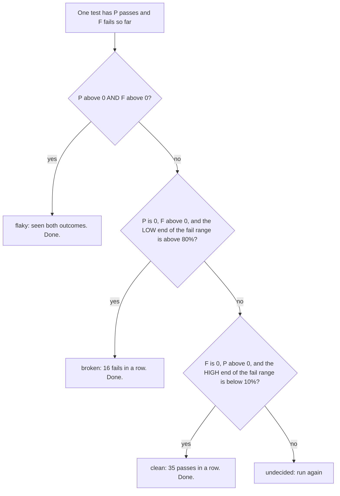
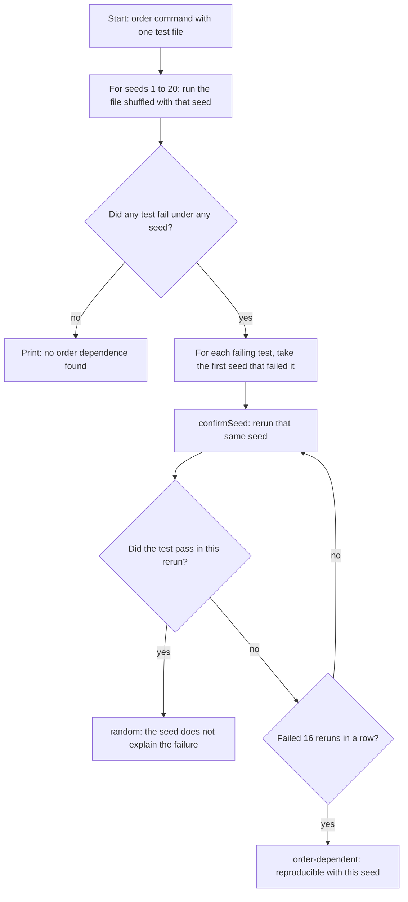

# Decision graph: what the tool does and why

Three diagrams, from the whole tool down to the details. Mermaid renders in
GitHub and in most Markdown viewers.

## 1. The whole `repeat` command (Layers 1 and 2)

Command: `node src/cli.ts [maxRuns]`

Reading it: the loop only continues while some test is undecided **and** runs
remain. Every pass through the loop narrows which files run.

## 2. `decide`: one test, one verdict (Layer 2)

Inputs: `P` = passes so far, `F` = fails so far, for one test.

The first matching rule wins. "Fail range" means the `wilson` range for the true
fail rate.

| Verdict | How many runs it takes |
|---|---|
| flaky | as few as 2 |
| undecided | not a result yet |
| broken | 16 fails in a row |
| clean | 35 passes in a row |

## 3. The `order` command (Layer 3)

Command: `node src/cli.ts order <test-file>`

Reading it: a failure that appears under a seed is only trusted if it appears
again **every time** that seed is rerun. One pass is enough to say it is random.

## How the diagrams fit together

| Question | Answered by |
|---|---|
| Did Vitest even run properly? | Diagram 1, the two STOP boxes |
| Is this test flaky, broken or clean? | Diagram 2 |
| Does the failure depend on test order? | Diagram 3 |

## The four fixtures traced through the graph

| Fixture | Diagram 1 and 2 verdict | Diagram 3 verdict |
|---|---|---|
| `stable` | clean after 35 runs | no failure under any seed |
| `random` | flaky after the first fail | random (it passes at some rerun) |
| `timing` | flaky within a few runs | random (it passes at some rerun) |
| `order` | **clean after 35 runs (blind spot)** | **order-dependent** (seed 3, 16 of 16) |

The `order` row is why Layer 3 exists: Diagram 2 alone gets it wrong.
